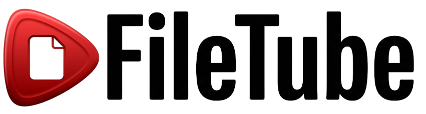
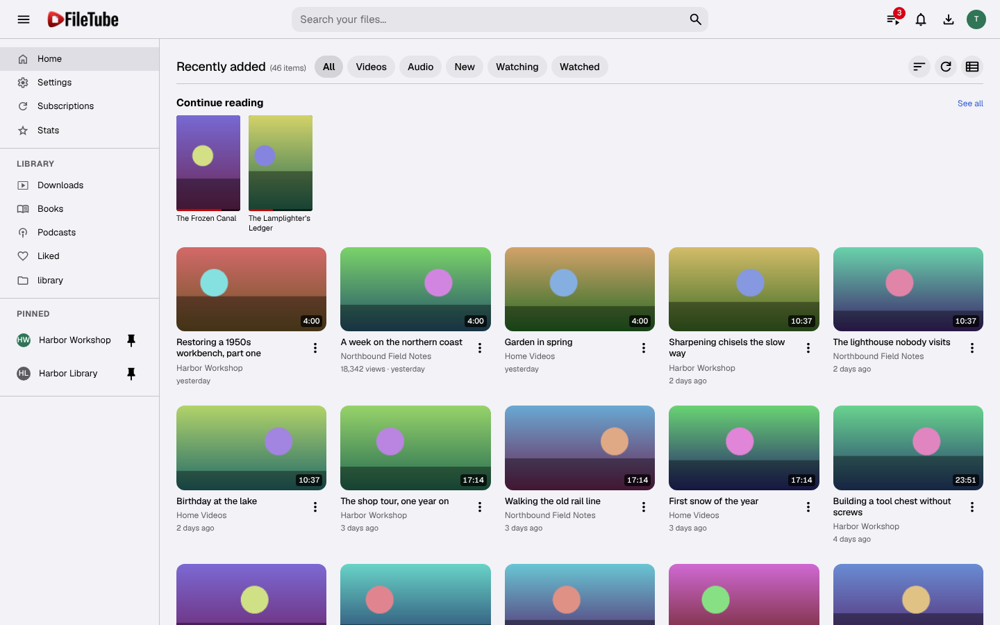
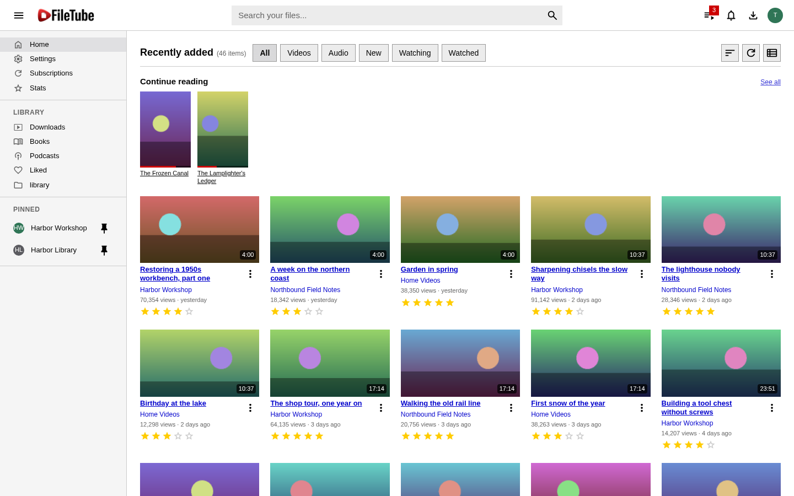
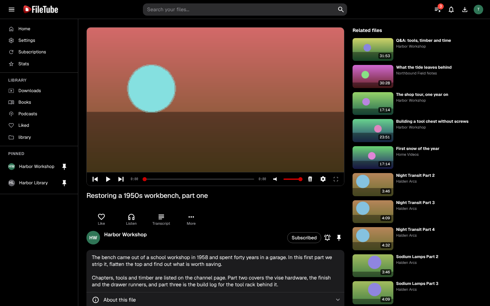
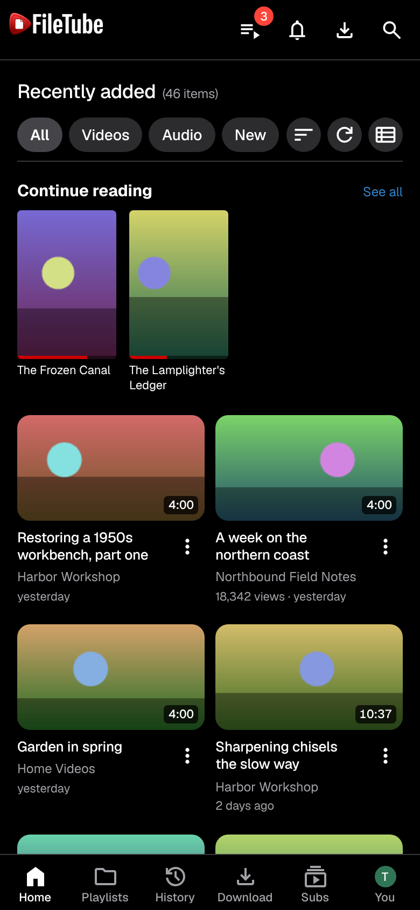
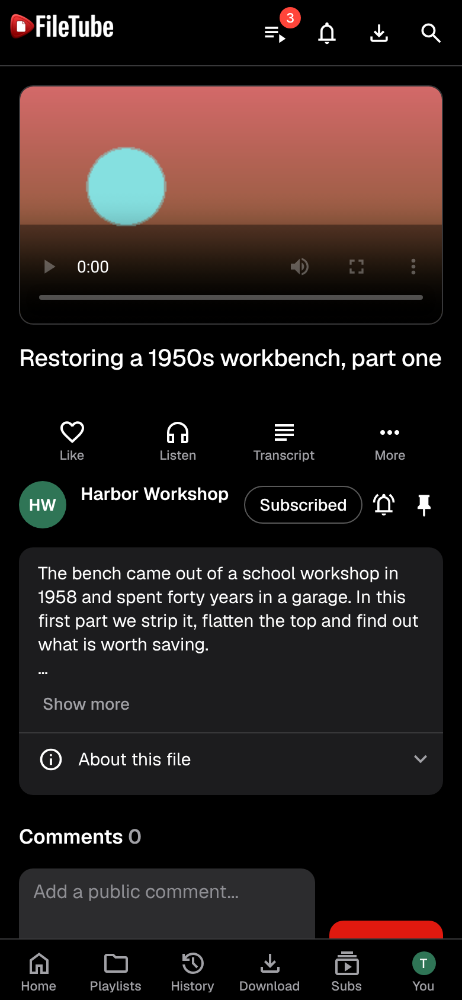
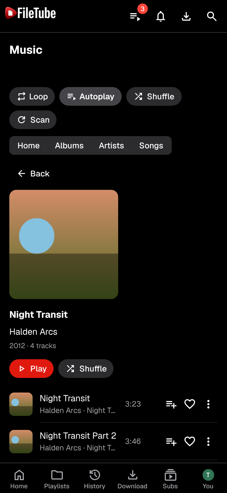
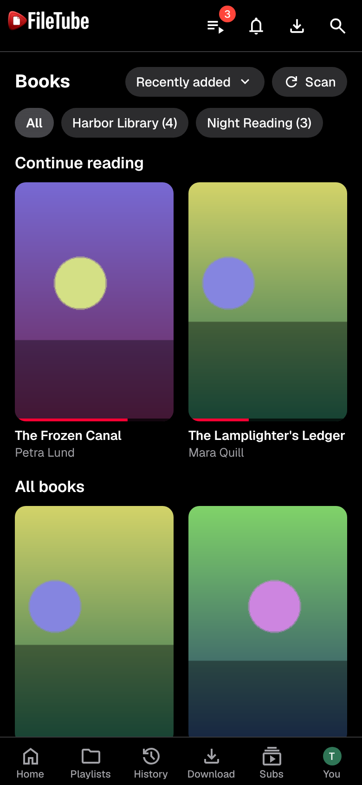
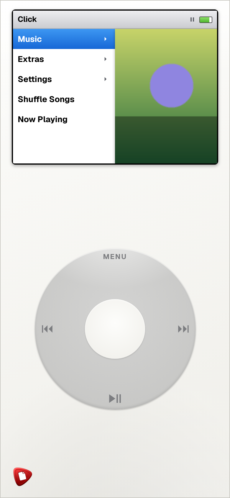

<div align="center">

<picture>
  <source media="(prefers-color-scheme: dark)" srcset="assets/images/filetube-banner-white.png">
  
</picture>

**Your media library, on every screen in the house.**

A lightweight, self-hosted media server with switchable retro looks.
Your videos, music, podcasts and books - on every screen in the house, and nowhere else.

[](https://github.com/dtammam/filetube/actions/workflows/ci.yml)
[](https://github.com/dtammam/filetube/actions/workflows/docker-publish.yml)
[](https://hub.docker.com/r/deantammam/filetube)
[](https://hub.docker.com/r/deantammam/filetube)
[](LICENSE)

[Quick Start](#quick-start-docker) · [Features](FEATURES.md) · [Screenshots](#screenshots) · [Configuration](docs/CONFIGURATION.md) · [Roadmap](ROADMAP.md)

</div>

---

FileTube is a self-hosted media server for your own video, music, podcasts and
books, with looks you can switch between (four eras, light or dark). It scans
your local folders and serves them through a web app that runs on your own
server or LAN in a single container, streams to desktop, phone (PWA) and Roku,
and keeps watch progress, likes and reading positions per account, synced
across devices. Your library never leaves your network: the only outbound
traffic is what you explicitly opt into.

Everything it can do, and how to turn each part on, is in
**[FEATURES.md](FEATURES.md)**.

## Screenshots

**Desktop - the 2021 era in light mode, then the 2005 era and the watch page:**

<p align="center">
  
</p>

<p align="center">
  
  &nbsp;
  
</p>

**Phone - the installed PWA, dark mode:**

<p align="center">
  
  &nbsp;
  
  &nbsp;
  
  &nbsp;
  
  &nbsp;
  
</p>

The screenshots use a synthetic demo library, not real media.

## Quick Start (Docker)

You'll need **Docker** with **Docker Compose**.

```bash
git clone https://github.com/dtammam/filetube.git
cd filetube
cp .env.example .env
```

Open `.env` and set the basics:

| Variable | What to put | Why |
|----------|------------|-----|
| `FILETUBE_IMAGE_TAG` | `latest` or a pinned version | Which container image to run |
| `SERVER_HOST_PORT` | e.g. `3000` | The port you'll browse to |
| `DATA_DIR` | e.g. `./data` | Database, thumbnails, art, caches |

Mount your media in `docker-compose.yml`:

```yaml
    volumes:
      - ./data:/app/data
      - /path/to/your/movies:/media/movies
      - /path/to/your/music:/media/music
```

Start it:

```bash
docker compose pull && docker compose up -d
```

Open [http://localhost:3000](http://localhost:3000). The first boot walks you
through creating the admin account; then open **Settings**, add your container
paths (e.g. `/media/movies`), and hit **Save & Scan Library**. Books and music
get their **own** folder boxes in Settings (the three sets must not overlap).

### Staying up to date

| `FILETUBE_IMAGE_TAG` | Behavior |
|-----|----------|
| `latest` | Newest **release** (recommended) |
| `1.4.2` | Pinned exactly - never moves |
| `1.4` / `1` | Latest within that line |
| `edge` | Newest `main` commit |

```bash
docker compose pull && docker compose up -d
```

Prefer automatic updates? Point [Watchtower](https://containrrr.dev/watchtower/)
at `latest`. Full tag scheme: [docs/RELEASING.md](docs/RELEASING.md).

## More

- **[FEATURES.md](FEATURES.md)** - every component, whether it is on by default, and how to enable it.
- **[Configuration reference](docs/CONFIGURATION.md)** - accounts, scan and cache tuning, the database, optional downloads, text-to-speech.
- **[Roadmap](ROADMAP.md)** - planned work and honest release notes.

## Local development (without Docker)

- Node.js **v22.13+** (SQLite via the `node:sqlite` builtin)
- FFmpeg on your PATH (optional; needed for thumbnails/transcoding)

```bash
npm install
npm start        # http://localhost:3000  (PORT=3001 npm start to override)
npm test         # the full suite
```

Architecture and contribution notes: [docs/ARCHITECTURE.md](docs/ARCHITECTURE.md) · [docs/CONTRIBUTING.md](docs/CONTRIBUTING.md)

## License

[MIT](LICENSE) © Dean Tammam

Pocket is inspired by classic click-wheel players. FileTube is not affiliated with Apple or Google.
